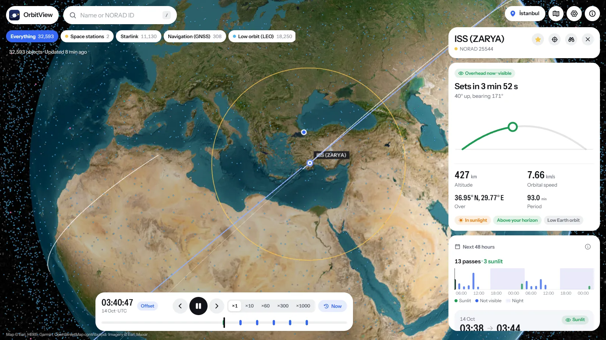
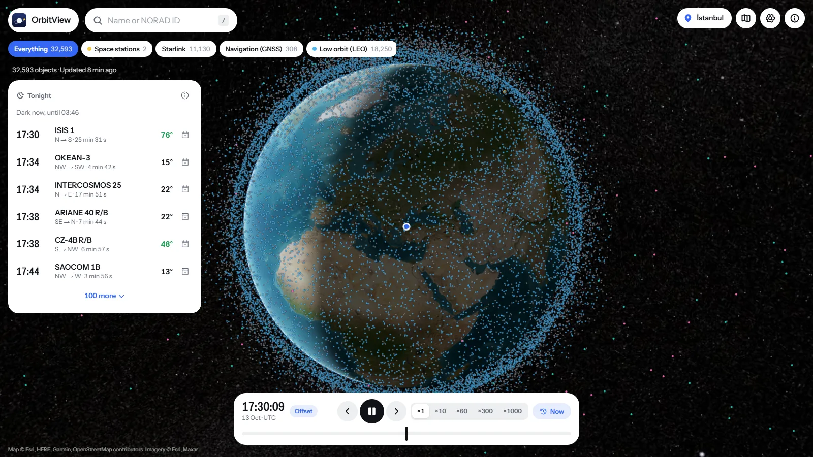
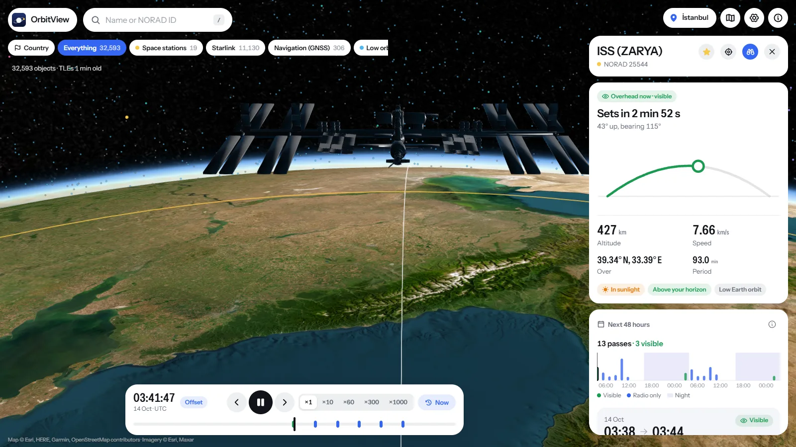
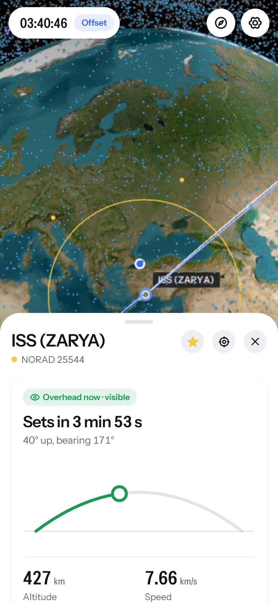
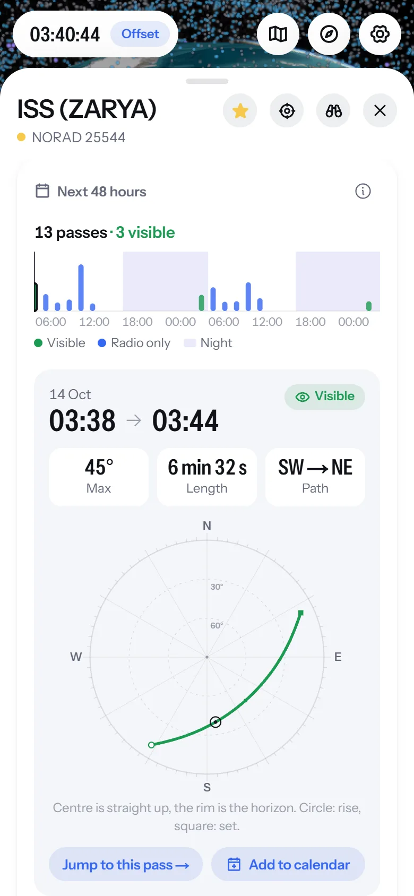
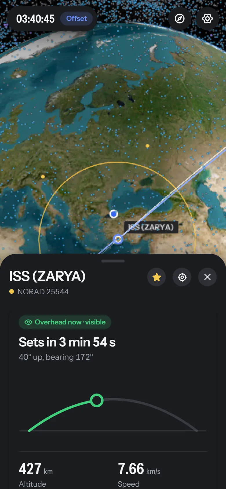

<p align="center">
  
</p>

<h1 align="center">OrbitView</h1>

<p align="center">
  Every tracked satellite on a 3D globe, with your passes, Doppler and orbit in one place.<br>
  <a href="https://orbitview-five.vercel.app"><b>orbitview-five.vercel.app</b></a> · <a href="README.tr.md">Türkçe</a>
</p>

<p align="center">
  
</p>

I built OrbitView because I wanted one place where I could see where a satellite
is, when it will pass over me, whether I'll be able to see it, and what
frequency to tune to — without four browser tabs and a spreadsheet. It runs
entirely in the browser: the public catalog is propagated with SGP4 on your
machine, so the numbers on screen are computed, not looked up.

Version 4 is a rewrite of most of the app. The physics got a careful second
look (and a few real fixes, listed below), and the interface was redesigned
from scratch.

## What it does

- **Live catalog.** The active satellites (and, with a Space-Track account, the
  full catalog including debris) drawn on a 3D globe, redrawn when something
  moves (up to about 15 times a second, not at all while paused). Colour shows
  the orbit: low Earth orbit in sky blue, MEO teal, geostationary violet,
  highly elliptical pink, debris grey; the two crewed stations (ISS and
  Tiangong) are yellow.
- **Passes over you.** For any object, the passes in the next 48 hours from
  your location: rise and set times to half a second, maximum elevation,
  direction, and whether it is sunlit while your sky is dark — at any point
  of the pass, not only at its highest. A strip shows all of them at once, with night shaded.
- **What matters now.** The first card changes with the situation:
  *overhead now, sets in 3 min*; *visible pass at 21:42, up to 63°*; or simply
  the next pass.
- **Doppler.** Received frequency and shift for common downlinks (ISS voice and
  APRS, Meteor LRPT, GPS L1, Ku band) or any frequency you type, plus
  the shift curve across the next pass.
- **Orbit.** Mean elements, perigee/apogee, period, inclination and how old the
  element set is.
- **Lifetime.** A rough decay estimate from the TLE drag term, with a range
  for solar activity and the current space weather from NOAA.
- **Close approaches.** Screens the loaded catalog for objects that come within
  5–25 km in the next 12–72 hours, with time of closest approach and relative
  speed.
- **Time travel.** Play, pause, ×10 to ×1000, jump by hours or drag the
  scrubber. Pass markers sit on the scrubber so you can drag straight to one.
- **Ephemeris export.** CSV or JSON from the simulation time, with the TLE and
  elements it came from.
- **Tonight.** Open the app in the evening and the first card lists the
  passes of the ~150 brightest satellites you can see with your own eyes
  tonight, in time order.
- **Calendar and alerts.** Put any pass in your calendar (an `.ics` with a
  reminder), or let the browser notify you a few minutes before passes of
  the satellites you've starred.
- **Who it belongs to.** Owner country, launch date and site, object type and
  radar size from the CelesTrak satellite catalog, and a country filter, so
  Türkiye's satellites are one tap away.
- **Globe or map.** Switch to a flat map when you want to read ground tracks.
- **The ISS up close.** NASA's 3D model of the station, and a camera that
  rides along just behind it.
- **Sky view on phones.** Point the phone at the sky; the view follows the
  compass and tilt sensors from your location.
- Light and dark appearance, Turkish and English, keyboard shortcuts, and links
  that open a specific object at a specific moment (`?sat=25544&t=2026-10-14T03:40Z`).

<p align="center">
  
  &nbsp;
  
</p>

<p align="center">
  
  &nbsp;
  
  &nbsp;
  
</p>

## Runs on modest hardware

The globe only draws when something on it changes. With time paused it
doesn't draw at all; at normal speed it redraws a few times a second, because
seen from 20,000 km a satellite moving at 7.6 km/s crosses two or three
pixels a second. Positions are recomputed off the main thread, only for what
the current filter shows, and long calculations run in a second worker so
they can't freeze the view.

On a slower phone or laptop the app switches itself to a lighter profile
(less anti-aliasing, no atmosphere shading, fewer updates); **Battery saver**
in Settings does the same on demand.

## How accurate is it?

As accurate as the input. TLEs fitted by the 18th Space Defense Squadron give
positions good to about a kilometre near their epoch for low orbits, and the
error grows by a few kilometres per day. OrbitView shows the age of every
element set and warns when it's more than two weeks old.

That's plenty for planning an observation or pointing a handheld antenna. It's
not good enough for operations; the close-approach screen in particular is a
"worth a look" list, not a collision prediction. Refraction isn't modelled, so
very low passes rise slightly earlier than shown.

What I did check is that the app doesn't add errors of its own. The test suite
compares every calculation against an independent reference:

| Check | Reference | Tolerance |
|---|---|---|
| Sidereal time | `satellite.gstime` across a whole day | 1e-12 rad |
| Doppler range rate | numerical derivative of the range | < 1 m/s |
| Geostationary Doppler | near zero by definition | < 20 m/s |
| Rise / set times | 1-second brute-force scan | ± 2 s |
| Culmination | 5-second scan of the pass | no higher sample |
| Close approach | twin orbit with a known offset | found, < 5 km |

More detail in [THEORY.md](THEORY.md) and [docs/validation.md](docs/validation.md).

### Fixed in 4.0

Three things in earlier versions were wrong, and I'd rather say so:

- **Doppler** used the inertial velocity rotated into the Earth-fixed frame but
  left out the Earth's rotation (the ω × r term). For a LEO satellite that is up
  to 0.4 km/s of range rate, about 200 Hz at 145.8 MHz.
- **Sidereal time** counted the time of day twice, up to about 1° by the end of
  each UTC day.
- **The neighbour search** for inter-satellite links missed most pairs between
  1000 and 2500 km. It drew nothing in the interface, so it's gone; close
  approaches now use a proper screening method instead.

## How it works

<p align="center"></p>

- **Data.** `/api/tle` fetches element sets from Space-Track (if configured) or
  CelesTrak, caches each group for two hours, sets CDN cache headers and never
  passes off stale data as fresh. The browser keeps the last good catalog in
  IndexedDB and refreshes it in the background. `/api/satcat` turns the 6 MB
  satellite catalog into a compact table of what's still in orbit, once a day.
- **Propagation.** A Web Worker runs SGP4 (satellite.js) over the whole catalog
  and hands back a `Float32Array` of Earth-fixed positions; the buffer goes back
  and forth so nothing is allocated per frame. Pass searches and close-approach
  screening also run in the worker.
- **Selected object.** Propagated on the main thread once a second, so its
  velocity, look angles and Doppler are exact rather than interpolated.
- **Time.** Cesium's clock is the master. The interface only sends user actions
  (seek, speed, play) to it, and reads the time back a few times a second.

Built with Next.js 16, React 19, CesiumJS, satellite.js, zustand, Motion and
Tailwind CSS.

## Running it locally

```bash
git clone https://github.com/SpaceEngineerSS/OrbitView.git
cd OrbitView
npm install        # also copies Cesium's static files into public/cesium
npm run dev
```

Then open http://localhost:3000.

Without any configuration it uses CelesTrak's *stations* and *active* groups
(about 16,000 objects). For the full catalog, add a free
[Space-Track](https://www.space-track.org) account in `.env.local`:

```bash
SPACETRACK_USER=you@example.com
SPACETRACK_PASS=your-password
```

CelesTrak limits how often the same data can be downloaded from one address
(roughly once every two hours per group). The server caches for that long; if
you restart the dev server repeatedly you may see a "showing older data" note
until the limit resets.

| Command | What it does |
|---|---|
| `npm run dev` | development server |
| `npm run build && npm start` | production build |
| `npm test` | Jest suite (science, data layer, API route) |
| `npm run check` | type check, lint and tests together |
| `npm run docs:snap` | retake the screenshots in `docs/img` (needs the dev server) |
| `npm run brand` | regenerate icons and the social preview from one SVG |

More in [docs/INSTALLATION.md](docs/INSTALLATION.md),
[docs/CONFIGURATION.md](docs/CONFIGURATION.md) and
[docs/DEPLOYMENT.md](docs/DEPLOYMENT.md).

## Project layout

```
src/
  app/            Next.js app router, /api/tle, layout and global styles
  components/
    analysis/     the inspector cards (passes, Doppler, orbit, lifetime …)
    globe/        Cesium viewer and its layers
    desktop/      desktop layout
    mobile/       phone layout and the bottom sheet
    common/       search, time controls, dialogs
    ui/           buttons, cards, switches, animated numbers
  lib/            orbit maths, pass search, Doppler, decay, catalog, data layer
  workers/        the propagation worker
  store/          zustand stores (app, time, telemetry, UI)
messages/         en.json, tr.json
scripts/          Cesium copy, screenshots, brand assets
```

## Credits

Orbital data and the satellite catalog from [CelesTrak](https://celestrak.org)
(T.S. Kelso) and [Space-Track.org](https://www.space-track.org). ISS model from
[NASA 3D Resources](https://science.nasa.gov/3d-resources/international-space-station-iss-b/)
(NASA/Michael D. Carbajal). Space weather from
[NOAA SWPC](https://www.swpc.noaa.gov). Map tiles © Esri and its data
providers. SGP4 by [satellite.js](https://github.com/shashwatak/satellite-js),
globe by [CesiumJS](https://cesium.com/platform/cesiumjs/).

## License

MIT. See [LICENSE](LICENSE). Issues and pull requests are welcome — see
[CONTRIBUTING.md](CONTRIBUTING.md).

— Mehmet Gümüş · [spacegumus.com.tr](https://spacegumus.com.tr)
