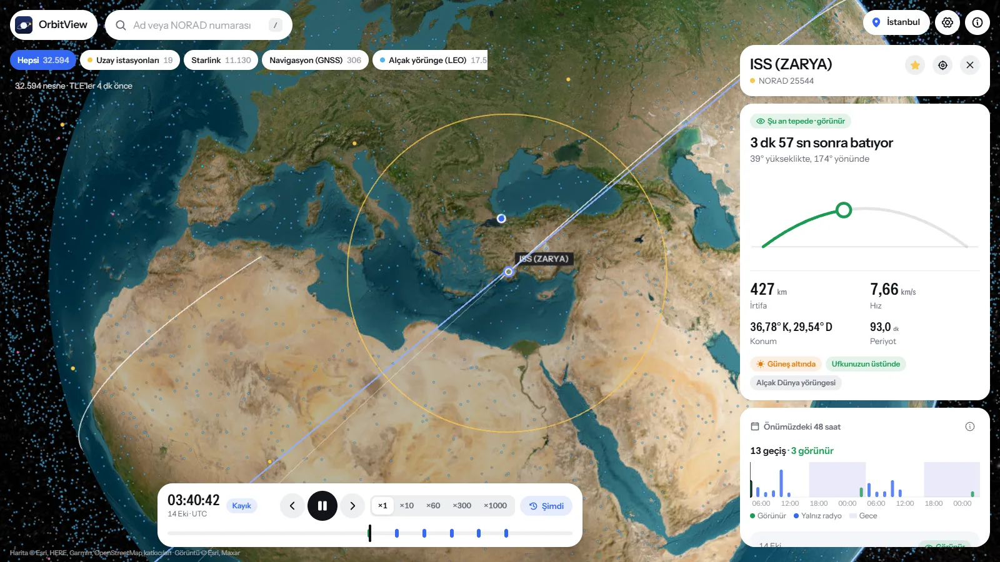
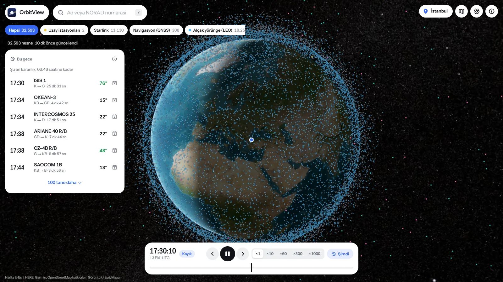
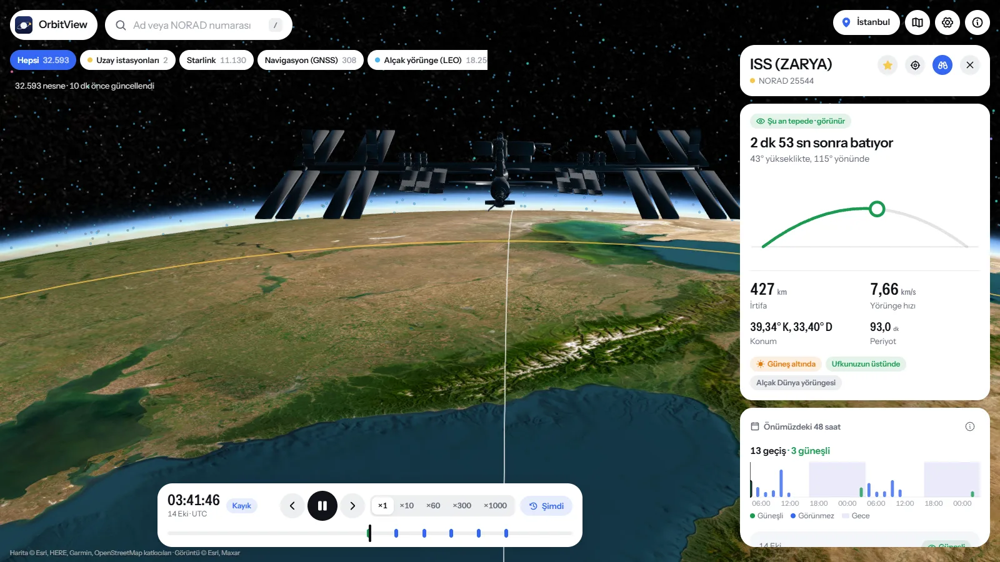
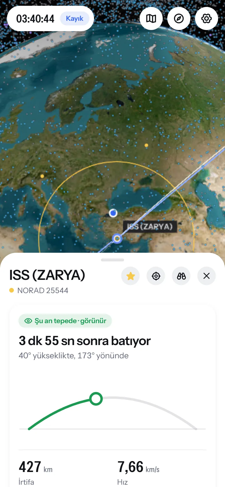
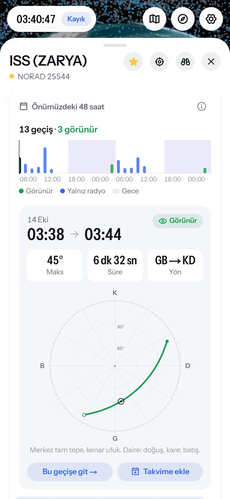
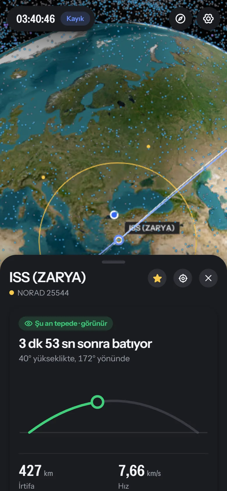
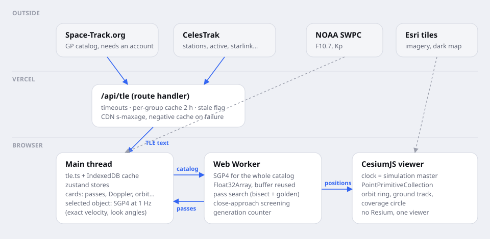

<p align="center">
  
</p>

<h1 align="center">OrbitView</h1>

<p align="center">
  Takip edilen her uydu 3B bir kürede; geçişleriniz, Doppler ve yörünge bilgisi tek yerde.<br>
  <a href="https://orbitview-five.vercel.app"><b>orbitview-five.vercel.app</b></a> · <a href="README.md">English</a>
</p>

<p align="center">
  
</p>

OrbitView'u, bir uydunun şu an nerede olduğunu, üzerimden ne zaman geçeceğini,
gözle görüp göremeyeceğimi ve telsizi hangi frekansa ayarlamam gerektiğini tek
ekranda görebilmek için yaptım. Dört sekme ve bir hesap tablosu açmadan.
Uygulama tamamen tarayıcıda çalışıyor: herkese açık katalog SGP4 ile sizin
makinenizde ilerletiliyor, yani ekrandaki sayılar bir yerden çekilmiyor,
hesaplanıyor.

4. sürüm uygulamanın büyük kısmının yeniden yazılmış hâli. Fizik tarafını
baştan dikkatle gözden geçirdim (aşağıda yazdığım birkaç gerçek düzeltme
çıktı) ve arayüzü sıfırdan tasarladım.

## Neler yapıyor

- **Canlı katalog.** Aktif uydular (Space-Track hesabıyla enkaz dahil tüm
  katalog) 3B kürede, saniyede 20 kez güncelleniyor. Renk yörüngeyi gösteriyor:
  alçak yörünge açık mavi, orta yörünge camgöbeği, yer eşzamanlı mor, yüksek
  eliptik pembe, istasyonlar sarı.
- **Üzerinizden geçişler.** Seçtiğiniz nesnenin konumunuzdan önümüzdeki 48
  saatteki geçişleri: yarım saniye hassasiyetle doğuş ve batış, en yüksek açı,
  yön ve gerçekten görüp göremeyeceğiniz (uydu güneş altında, sizin
  gökyüzünüz karanlık). Hepsi gece bölümleri gölgeli tek bir şeritte.
- **Şu an önemli olan.** İlk kart duruma göre değişiyor: *şu an tepede, 3 dk
  sonra batıyor*; *görünür geçiş 21:42, en fazla 63°*; ya da sadece sıradaki
  geçiş.
- **Doppler.** Bilinen iniş frekansları (ISS ses ve APRS, NOAA APT, Meteor LRPT,
  GPS L1, Ku bandı) ya da yazdığınız herhangi bir frekans için alınan frekans ve
  kayma; sıradaki geçiş boyunca kayma eğrisi.
- **Yörünge.** Ortalama elemanlar, yerberi/yeröte, periyot, eğim ve eleman
  setinin yaşı.
- **Ömür.** TLE sürüklenme teriminden kaba bir bozunma tahmini; güneş
  etkinliğine göre aralık ve NOAA'dan anlık uzay havası.
- **Yakın geçişler.** Yüklü katalogda önümüzdeki 12–72 saatte 5–25 km'den yakına
  gelen nesneleri tarıyor; en yakın geçiş anı ve bağıl hızla birlikte.
- **Zamanda gezinme.** Oynat, durdur, ×10'dan ×1000'e hız, saat saat atla ya da
  kaydırıcıyı sürükle. Geçişler kaydırıcının üzerinde işaretli, doğrudan
  sürükleyip gidebiliyorsunuz.
- **Efemeris dışa aktarma.** Simülasyon zamanından başlayan CSV ya da JSON;
  kaynak TLE ve elemanlarla birlikte.
- **Bu gece.** Uygulamayı akşam açtığınızda ilk kart, bu gece kendi
  gözünüzle görebileceğiniz en parlak ~100 uydunun geçişlerini saat sırasıyla
  gösterir.
- **Takvim ve uyarılar.** İstediğiniz geçişi hatırlatıcılı bir `.ics` olarak
  takviminize ekleyin ya da yıldızladığınız uyduların geçişinden birkaç dakika
  önce tarayıcı bildirimi alın.
- **Kimin uydusu.** CelesTrak uydu kataloğundan sahibi olan ülke, fırlatma
  tarihi ve yeri, nesne türü ve radar boyutu. Ülke filtresiyle Türkiye'nin
  uyduları tek dokunuş uzakta.
- **Küre ya da harita.** Yer izlerini okumak için düz haritaya geçin.
- **ISS yakından.** NASA'nın istasyon 3B modeli ve hemen arkasından onunla
  birlikte uçan bir kamera.
- **Telefonda gökyüzü görünümü.** Telefonu gökyüzüne doğrultun; görünüm
  konumunuzdan pusula ve eğim sensörlerini takip ediyor.
- Açık ve koyu görünüm, Türkçe ve İngilizce, klavye kısayolları ve belirli bir
  nesneyi belirli bir anda açan bağlantılar (`?sat=25544&t=2026-10-14T03:40Z`).

<p align="center">
  
  &nbsp;
  
</p>

<p align="center">
  
  &nbsp;
  
  &nbsp;
  
</p>

## Mütevazı cihazlarda da akıcı

Küre yalnızca üzerinde bir şey değiştiğinde çiziliyor. Zaman durdurulmuşken
hiç çizilmiyor; normal hızda saniyede birkaç kez yenileniyor, çünkü 20.000
km'den bakınca 7,6 km/s hızla giden bir uydu saniyede iki üç piksel ilerliyor.
Konumlar ana iş parçacığının dışında ve yalnızca filtrenin gösterdiği nesneler
için hesaplanıyor; uzun hesaplar ikinci bir worker'da çalışıyor, görüntüyü
donduramıyor.

Daha yavaş bir telefon ya da dizüstünde uygulama kendiliğinden hafif profile
geçiyor (daha az kenar yumuşatma, atmosfer gölgelemesi yok, daha seyrek
güncelleme); Ayarlar'daki **Pil tasarrufu** aynısını istediğiniz zaman yapar.

## Ne kadar doğru?

Girdi ne kadar doğruysa o kadar. 18. Uzay Savunma Filosu'nun yayımladığı
TLE'ler alçak yörüngede epok civarında yaklaşık bir kilometre doğrulukta konum
verir; hata her gün birkaç kilometre büyür. OrbitView her eleman setinin yaşını
gösteriyor ve iki haftadan eskiyse uyarıyor.

Bir gözlemi planlamak ya da el anteniyle uyduyu takip etmek için bu fazlasıyla
yeterli; operasyon için değil. Özellikle yakın geçiş taraması bir çarpışma
tahmini değil, "bakmaya değer" listesi. Atmosferik kırılma hesaba katılmıyor;
çok alçak geçişler gerçekte biraz daha erken doğar.

Benim kontrol ettiğim şey, uygulamanın kendi hatasını eklememesi. Test
paketi her hesabı bağımsız bir referansla karşılaştırıyor:

| Kontrol | Referans | Tolerans |
|---|---|---|
| Yıldız zamanı | gün boyunca `satellite.gstime` | 1e-12 rad |
| Doppler uzaklık değişimi | uzaklığın sayısal türevi | < 1 m/s |
| Yer eşzamanlı Doppler | tanım gereği sıfıra yakın | < 20 m/s |
| Doğuş / batış | 1 saniyelik kaba kuvvet tarama | ± 2 sn |
| Tepe noktası | geçişin 5 saniyelik taraması | daha yüksek örnek yok |
| Yakın geçiş | bilinen ofsetli ikiz yörünge | bulunuyor, < 5 km |

Ayrıntılar [THEORY.md](THEORY.md) ve [docs/validation.md](docs/validation.md)
dosyalarında.

### 4.0'da düzeltilenler

Önceki sürümlerde üç şey yanlıştı; bunu açıkça yazmayı tercih ederim:

- **Doppler**, eylemsiz hızı Dünya'ya sabit çerçeveye döndürüyor ama Dünya'nın
  dönüşünü (ω × r terimini) hesaba katmıyordu. Alçak yörüngedeki bir uydu için
  bu, uzaklık değişiminde 0,4 km/s'ye, 145,8 MHz'te yaklaşık 200 Hz'e varan bir
  hata demek.
- **Yıldız zamanı** günün saatini iki kez sayıyordu; her UTC gününün sonuna
  doğru hata yaklaşık 1°'ye çıkıyordu.
- **Uydular arası bağlantı için komşu araması** 1000–2500 km arasındaki
  çiftlerin çoğunu kaçırıyordu. Arayüzde hiçbir şey çizmediği için kaldırdım;
  yakın geçişler artık düzgün bir tarama yöntemi kullanıyor.

## Nasıl çalışıyor

<p align="center"></p>

- **Veri.** `/api/tle`, eleman setlerini (ayarlıysa) Space-Track'ten ya da
  CelesTrak'ten çekiyor, her grubu iki saat önbellekte tutuyor, CDN başlıklarını
  ayarlıyor ve eski veriyi asla yeniymiş gibi sunmuyor. Tarayıcı son sağlam
  kataloğu IndexedDB'de saklıyor ve arka planda yeniliyor. `/api/satcat`, 6
  MB'lık uydu kataloğunu günde bir kez yörüngede kalanların kompakt bir
  tablosuna çeviriyor.
- **İlerletme.** Bir Web Worker tüm katalog için SGP4 (satellite.js) çalıştırıp
  Dünya'ya sabit konumları bir `Float32Array` içinde geri veriyor; tampon
  gidip geliyor, her karede yeni bellek ayrılmıyor. Geçiş araması ve yakın
  geçiş taraması da worker'da.
- **Seçili nesne.** Ana iş parçacığında saniyede bir ilerletiliyor; böylece hızı,
  bakış açıları ve Doppler değeri ara değer değil, kesin hesap.
- **Zaman.** Ana saat Cesium'un saati. Arayüz ona yalnızca kullanıcı eylemlerini
  (konuma git, hız, oynat) gönderiyor ve zamanı saniyede birkaç kez geri okuyor.

Next.js 16, React 19, CesiumJS, satellite.js, zustand, Motion ve Tailwind CSS
ile yapıldı.

## Yerelde çalıştırma

```bash
git clone https://github.com/SpaceEngineerSS/OrbitView.git
cd OrbitView
npm install        # Cesium'un statik dosyalarını public/cesium'a da kopyalar
npm run dev
```

Ardından http://localhost:3000 adresini açın.

Hiç ayar yapmadan CelesTrak'in *stations* ve *active* gruplarını kullanır
(yaklaşık 16.000 nesne). Tüm katalog için `.env.local` dosyasına ücretsiz bir
[Space-Track](https://www.space-track.org) hesabı ekleyin:

```bash
SPACETRACK_USER=siz@ornek.com
SPACETRACK_PASS=sifreniz
```

CelesTrak, aynı verinin aynı adresten ne sıklıkla indirilebileceğini sınırlıyor
(grup başına kabaca iki saatte bir). Sunucu da o kadar süre önbellekte tutuyor;
geliştirme sunucusunu sık sık yeniden başlatırsanız sınır sıfırlanana kadar
"eski veri gösteriliyor" notunu görebilirsiniz.

| Komut | Ne yapar |
|---|---|
| `npm run dev` | geliştirme sunucusu |
| `npm run build && npm start` | üretim derlemesi |
| `npm test` | Jest testleri (bilim, veri katmanı, API) |
| `npm run check` | tip denetimi, lint ve testler bir arada |
| `npm run docs:snap` | `docs/img` içindeki ekran görüntülerini yeniden alır (geliştirme sunucusu açık olmalı) |
| `npm run brand` | ikonları ve paylaşım görselini tek bir SVG'den üretir |

Ayrıntılar [docs/INSTALLATION.md](docs/INSTALLATION.md),
[docs/CONFIGURATION.md](docs/CONFIGURATION.md) ve
[docs/DEPLOYMENT.md](docs/DEPLOYMENT.md) dosyalarında.

## Teşekkür

Yörünge verisi ve uydu kataloğu [CelesTrak](https://celestrak.org) (T.S. Kelso)
ve [Space-Track.org](https://www.space-track.org); ISS modeli
[NASA 3D Resources](https://science.nasa.gov/3d-resources/international-space-station-iss-b/)
(NASA/Michael D. Carbajal); uzay havası
[NOAA SWPC](https://www.swpc.noaa.gov); harita karoları © Esri ve veri
sağlayıcıları. SGP4 için [satellite.js](https://github.com/shashwatak/satellite-js),
küre için [CesiumJS](https://cesium.com/platform/cesiumjs/).

## Lisans

MIT. [LICENSE](LICENSE) dosyasına bakın. Hata bildirimleri ve katkılar
memnuniyetle karşılanır; [CONTRIBUTING.md](CONTRIBUTING.md) dosyasına göz atın.

— Mehmet Gümüş · [spacegumus.com.tr](https://spacegumus.com.tr)
